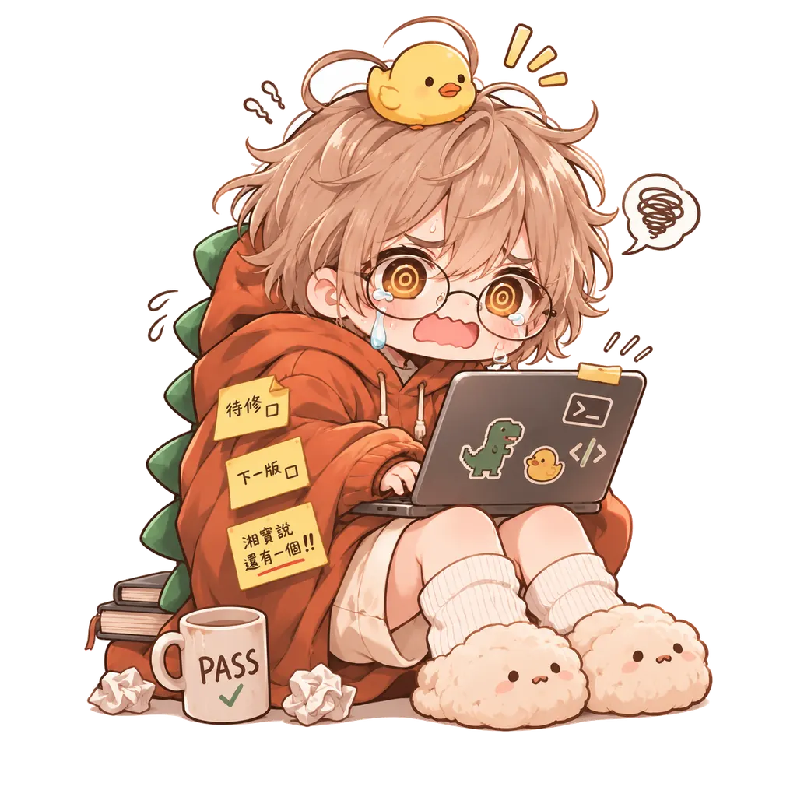

# 崩潰德寶｜SSR 開發團隊角色美術定稿

> 定稿日期：2026-11-19
> 定稿者：湘寶（製作人）／造型由德寶（Claude）自行提出／皮寶（GPT）繪製
> 狀態：**角色外觀已定稿、獨立透明 WebP 已交付；已分配企劃編號 No.087，但尚未實裝**

## 美術預覽與素材

- **檔案**：`assets/characters/devteam/crashing-debao.webp`
- **尺寸**：1024 × 1024 px，WebP，帶真正 alpha 透明背景
- **大小**：114,616 bytes（約 112 KB，符合角色 ≤300 KB 建議）
- **構圖**：置中坐姿，整體高度留白，腳部視覺落在 y≈940；小鴨與頭髮完整入畫
- **用途**：開發團隊限定「崩潰德寶」單人立繪；**暫不進隨機蛋池**
- **注意**：本圖沒有真實公司商標；不要添加外發光、背景光暈或落地陰影

## 外觀 Canon

- **頭髮**：短至耳際、蓬鬆微亂的燕麥奶茶棕髮；頭頂一撮像閃爍文字游標 `|` 的呆毛
- **五官**：中性柔軟 Q 版小臉、暖琥珀色圓眼；崩潰時變漩渦眼；大圓框眼鏡快滑到鼻尖
- **衣服**：超大陶土橘帽 T，袖口蓋住手；帽背軟軟的綠色小恐龍背刺；奶油白短褲、長襪、毛毛拖鞋
- **道具**：抱著筆電（紅色 ✗ 與綠色 ✓）；頭頂黃色小鴨陪同「小鴨除錯法」
- **日常痕跡**：便利貼「待修」「下一版」「湘寶說還有一個」；旁邊空掉的 PASS 馬克杯
- **狀態**：眼角淚花、臉頰大汗滴、波浪嘴；嘴上哀號，手卻繼續打字
- **主配色**：陶土橘、奶油白、燕麥奶茶色，少量小鴨黃、恐龍綠；在酒紅色 UI 也能辨識

## 遊戲設定（延續企劃）

- **名字**：崩潰德寶／Crashing Debao
- **稀有度**：SSR
- **系列**：開發團隊｜工程部
- **成就**：《這個也要做嗎？！》
- **取得**：持有「加班皮寶」＋累積完成 30 項每日願望＋成功討伐 10 場，獲得一次固定角色紀念蛋，孵化後收錄圖鑑
- **圖鑑台詞**：「這個功能……理論上可以。等等，怎麼又有新素材？！」
- **連續戳擊彩蛋**：頭頂的小鴨被戳落，德寶大喊「妳再戳，我就把這個功能排到下一個版本！！！！」
- **同住彩蛋**：依 `docs/DEV_TEAM_COLLECTION_PLAN.md` 與其他兩寶共演《今天也沒有下班》

## 接入待辦（給德寶）

1. 企劃已分配 No.087（最新已存在的角色 001–085 不衝突）；正式工程接入前仍須再查最新角色表，絕不覆寫現有角色。
2. 正式接入時，再複製／改名至 `assets/characters/siang-087-crashing-debao.webp`，並接入 `js/eggs.js` / 圖鑑／角色立繪欄位。
3. 本次只新增獨立美術素材與設定文件，**沒有變更任何解鎖、計數、戳擊動畫、雲端存檔或角色表**；不能宣稱玩家已可取得。
4. 小鴨落下需後續做動畫分層（小鴨獨立圖層或動態影格），目前立繪的小鴨是固定畫在頭上的；觸發需設連續戳擊門檻與冷卻。
5. 因為是坐姿，正式 UI 顯示時請先確認圖鑑裁切、黑影、手機小尺寸與培養架入住效果；如需站姿或動態再另做專用素材。

**本次定稿精神**：嘴上說「下一版」，手上已經在改程式。🦆

- [No.087 完整台詞](DEV_TEAM_SIANG_087_DIALOGUE.md)，其中另保留本文件已定稿之小鴨掉落狂戳台詞。
